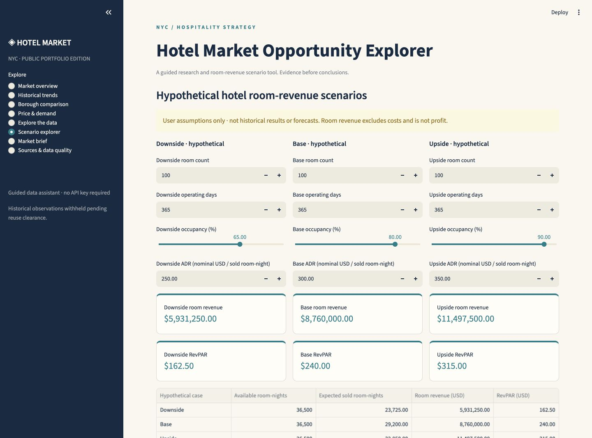
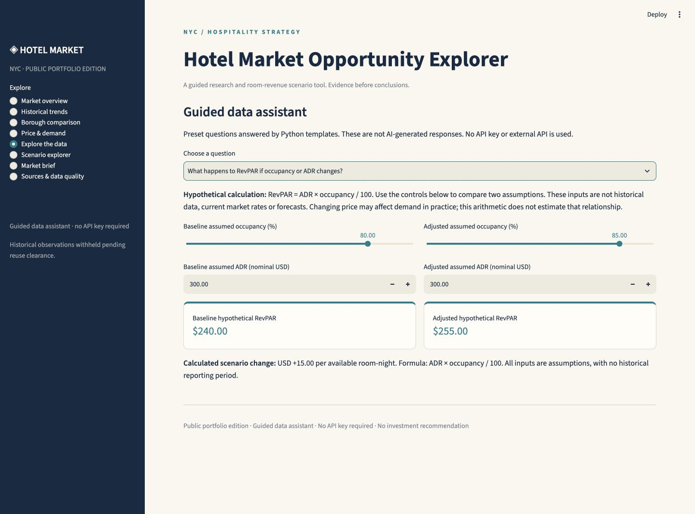
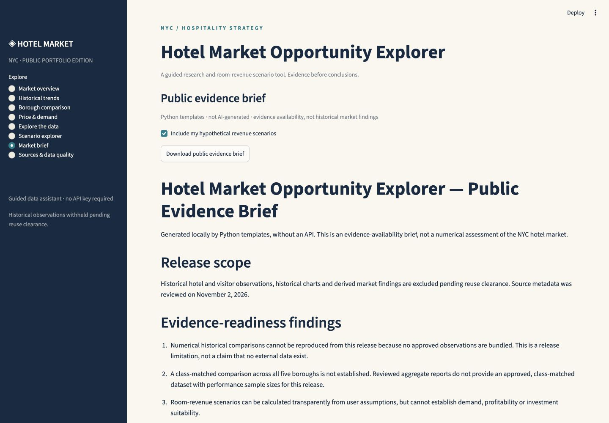

# Hotel Market Opportunity Explorer

[Open the live app](https://hotel-market-opportunity-explorer.streamlit.app/)

**Explore hotel revenue assumptions without hiding the evidence gaps.**

Hospitality strategy depends on how room price, occupancy and capacity interact—not just headline rates. This Streamlit portfolio app lets a reviewer compare hypothetical hotel revenue cases, work through guided questions and download an evidence-availability brief. It also makes clear when the public data cannot support a market claim.

Built with **Python · Streamlit · pandas · Plotly**. The **guided data assistant requires no API key** and uses Python templates, not AI-generated chat.

## App preview

Actual screenshots captured from the running **public app**, not mockups. Every amount shown is a **hypothetical input or calculated scenario result**. No excluded historical dataset, historical chart or research screenshot is used here. Browser tabs, credentials and personal information are outside the captures.

### 1. Compare hotel revenue scenarios

Open **Scenario explorer** and edit rooms, operating days, occupancy and nominal ADR for downside, base and upside cases. Python calculates available room-nights, expected sold room-nights, room revenue and RevPAR. Review the revenue chart and export the assumptions/results as CSV. Room revenue is **before costs, not profit**.



### 2. Explore a question with the guided data assistant

Choose one of five presets under **Explore the data**. The RevPAR preset compares two user-defined assumptions and explains the arithmetic. Historical questions return source references and an explicit evidence-unavailable explanation rather than invented results. No API key, external model or AI chat is involved.



### 3. Download a public evidence brief

Open **Market brief** and download a Markdown summary of evidence availability, risks, source reporting periods and reuse limitations. Optionally include the revenue cases you just edited in a separate hypothetical section. This implemented download is an **evidence-availability brief**, not a historical market assessment.



## Implemented versus planned

| Available in the public app today | Planned additions; not publicly available today |
|---|---|
| Editable hotel revenue scenarios, calculated outputs, Plotly chart and CSV export | Historical numerical KPI cards and trend charts, subject to reuse clearance |
| Five-question guided data assistant, with local Python calculations and evidence-limit explanations | Like-for-like borough rate/occupancy comparisons, subject to matched hotel categories, periods and reporting populations |
| Downloadable public evidence brief with optional hypothetical cases | Historical market findings, after appropriate source and upstream redistribution rights are documented |
| Primary-source register, reporting coverage, reuse notes and borough coverage review | Permissioned numerical datasets with documented sample coverage |

Historical numerical observations are **withheld pending reuse clearance**. The current public repository does not provide historical hotel results, borough price/occupancy rankings or investment recommendations. The complete original research version is preserved locally and is not redistributed here. See [excluded data and reuse decisions](docs/DATA_REUSE.md).

## Tools and methodology

- **Python:** deterministic scenario formulas, validation and template-generated explanations/briefs.
- **Streamlit:** interactive application; `app.py` is the entry point.
- **pandas:** scenario tables and source-coverage presentation.
- **Plotly:** labelled charts of hypothetical revenue.
- **pytest / Streamlit AppTest:** calculations, validation, page interactions and operation without secrets.

The research register records primary publishers, URLs, reporting periods, retrieval dates, geographic coverage and unresolved reuse conditions. Historical comparisons require matching periods, units, geography, hotel categories and reporting populations. Scenarios never fill missing historical observations, and arithmetic relationships do not establish causation.

## Run locally

Use Python **3.12**, the version selected for deployment.

```bash
git clone https://github.com/Joe05062000/hotel-market-opportunity-explorer.git
cd hotel-market-opportunity-explorer
python3 -m venv .venv
source .venv/bin/activate
python -m pip install -r requirements.txt
streamlit run app.py
```

On Windows, activate with `.venv\Scripts\activate`. No API key or account sign-in is required to run the app.

`app.py` at the repository root is the Streamlit entry point. `requirements.txt` pins Streamlit, pandas and Plotly to the locally verified versions. No system packages are required. **Do not add any secrets for this public app.** It neither reads API keys nor calls an AI service. An optional AI experiment exists only in the separate local research workspace and is not a public feature.

## Calculations and assumptions

Occupancy is entered as a percentage and converted to a decimal:

```text
Available room-nights = rooms × operating days
Sold room-nights      = available room-nights × occupancy / 100
Room revenue          = sold room-nights × ADR
RevPAR                = ADR × occupancy / 100
```

All default cases and user edits are hypothetical, with no historical reporting dates. Expected sold room-nights may be fractional. If rooms or operating days differ, changes in revenue also reflect capacity or horizon. Price-demand response, seasonality, costs and taxes are not modeled. Room revenue excludes costs and is **not profit**. No opportunity score or investment recommendation is generated.

## Sources and data limitations

The metadata register links to NYC Tourism + Conventions / Tourism Economics publications, NYC Comptroller reports, NYS Comptroller reports, and NYC Department of Finance and Department of City Planning publications. It identifies annual, monthly, year-to-date and tax-year coverage separately.

The reviewed borough snapshot names Manhattan, Brooklyn and Queens; the Bronx and Staten Island are absent from that selected table. Category-matched hotel rates, a fixed hotel panel and performance sample sizes are not established. Realized ADR is not an advertised booking price. No booking websites were scraped and Airbnb data are not used as hotel data.

See [the source register](data/sources.json), [release manifest](data/release_manifest.json) and [specific data-reuse review](docs/DATA_REUSE.md). Public access and attribution do not grant permission. In particular, NYC Comptroller materials restrict commercial use; tourism/STR reuse rights remain unverified; NYC.gov rights are reserved. The public repository excludes original numerical observations, historical derivatives, publisher media and full reports. No third-party data license is claimed.

To enable historical results later, document applicable public-display **and** redistribution rights, review upstream rights, and then add validated observations through a deliberate release change. Do not merely turn a flag on or upload unapproved data.

## Verify the public release

```bash
python -m pip install -r requirements-dev.txt
python -m pytest -q
python scripts/check_release.py
python -m pip check
```

Tests check scenario arithmetic, invalid inputs, missing historical evidence, all guided presets, every page without secrets, scenario interaction and evidence-brief boundaries. The release check verifies the file allowlist, metadata-only manifest, absence of unapproved data/media and common credential patterns. These checks do not establish legal permission or replace source review.

Only the contents of this prepared public repository should be pushed. Do not copy the parent research directory, `.venv`, `.env`, secrets, generated historical briefs or screenshots into it.

## Live deployment

The public app is deployed on [Streamlit Community Cloud](https://hotel-market-opportunity-explorer.streamlit.app/).

| Setting | Value |
|---|---|
| Repository | `Joe05062000/hotel-market-opportunity-explorer` |
| Branch | `main` |
| Main file path | `app.py` |
| Python version | `3.12` |
| Secrets | None required or configured |
| Visibility | Public |

The deployed scenario explorer, guided assistant and Markdown brief download were verified on November 6, 2026. The complete original research application remains local; only this public release is hosted. Historical observations remain withheld as documented above.

See [deployment details](docs/DEPLOYMENT.md). Future changes pushed to `main` are picked up by Community Cloud. Follow [Streamlit’s deployment guide](https://docs.streamlit.io/deploy/streamlit-community-cloud/deploy-your-app/deploy) when changing runtime settings or creating another deployment.
